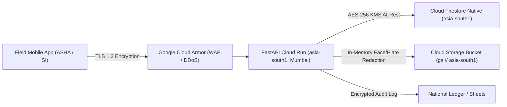

# Privacy Policy — NidanIQ

**National Digital Public Infrastructure for Vector-Borne Disease Control**
*Aligned with the Digital Personal Data Protection (DPDP) Act, 2023, Information Technology Act, 2000, and NCVBDC / MoHFW Standards*

**Document Version:** 1.0.0
**Effective Date:** October 23, 2026
**Last Updated:** October 23, 2026
**Data Hosting Jurisdiction:** Republic of India (Mumbai Region `asia-south1`)

---

## 1. Preamble and Executive Overview

NidanIQ ("Platform", "We", "Us", or "Our") is the sovereign National Digital Public Infrastructure (DPI) for automated vector-borne disease surveillance, micro-climate predictive modeling, and municipal response orchestration. The Platform operates in strict compliance with the **Digital Personal Data Protection (DPDP) Act, 2023 (Act No. 22 of 2023)**, the **Information Technology Act, 2000**, the **Information Technology (Reasonable Security Practices and Procedures and Sensitive Personal Data or Information) Rules, 2011**, and statutory public health operational guidelines issued by the **National Center for Vector Borne Diseases Control (NCVBDC)** and the **Ministry of Health and Family Welfare (MoHFW)**, Government of India.

This Privacy Policy delineates the precise technical and legal framework governing the collection, processing, storage, pseudonymization, redaction, and protection of personal data and field telemetry gathered through the NidanIQ mobile application, administrative command consoles, automated IoT telemetry, and public epidemiological APIs.

---

## 2. Identity and Coordinates of the Data Fiduciary

Under Section 2(i) of the Digital Personal Data Protection Act, 2023, the designated **Data Fiduciary** responsible for determining the purpose and means of data processing is:

* **Entity Name:** NidanIQ
* **Headquarters:** Mohali, Punjab (India)
* **Data Sovereignty Region:** Mumbai (asia-south1)
* **Official Institutional Email:** `support@example.com`
* **Official Grievance Desk:** `grievance.dpo@example.com`

---

## 3. Scope and Applicability

This Policy governs:
1. **Accredited Frontline Healthcare Workers & Field Staff:** Accredited Social Health Activists (ASHA), Auxiliary Nurse Midwives (ANM), Multi-Purpose Health Workers (MPHW), Sanitary Sub-Inspectors (SSI), and Municipal Sanitary Inspectors (SI).
2. **Supervisory & Clinical Authorities:** Medical Officers of Health (MOH), District Surveillance Officers (DSO), Chief Medical Officers (CMO), and State Nodal Epidemiologists.
3. **Public Health Consumers & Research Partners:** Entities and citizens accessing open epidemiological risk scores, the Dengue Potential Index (DPI), or authorized Open Government Data (OGD) integration feeds.

---

## 4. Categories of Data Collected

NidanIQ enforces strict **Data Minimization** as mandated under Section 6(1) of the DPDP Act, 2023. The platform collects only data strictly necessary for disease surveillance and rapid municipal vector control:

### A. Authenticated Officer Identity & Account Data
* **Mobile Telephone Number:** Processed via Firebase Phone Authentication using one-time cryptographic SMS passcodes (OTP). Phone numbers are cross-referenced solely against the accredited Municipal Staff Directory.
* **Professional Credentials:** Officer Full Legal Name, Government Employee Designation, Government Department/Cadre, and Official Government Email Address (`*.gov.in` or designated roster email).
* **Jurisdictional Allocations:** Assigned Administrative Ward Number, Sector/Zone, and 10-digit Local Government Directory (LGD) Administrative Ward Code (e.g., `04-001-00001` through `04-001-00035`).

### B. Geospatial & Telemetry Data
* **High-Precision GPS Coordinates:** Latitude, longitude, horizontal accuracy radius, elevation, speed, bearing, and system timestamp recorded during active field inspections and chemical fogging van movements.
* **Geofencing Verification:** Validation that the officer is physically positioned within their allocated municipal ward boundary during data submission.

### C. Field Entomological Surveillance Telemetry
* **Household & Container Audits:** Total residential/commercial premises visited, wet containers inspected, positive containers identified, container typology (e.g., overhead plastic tanks, desert coolers, discarded rubber tires, mud pots, construction pits).
* **Entomological Risk Indices:** Real-time computation of statutory NCVBDC indices:
  * **House Index ($HI$):** Percentage of houses infested with larvae/pupae.
  * **Container Index ($CI$):** Percentage of water-holding containers infested.
  * **Breteau Index ($BI$):** Number of positive containers per 100 houses inspected.

### D. Geotagged Site Inspection Imagery & Automated DPDP PII Redaction
* **Photographic Evidence:** Digital photographs captured by field officers to document standing water, larval clusters, or discarded solid waste breeding sites.
* **Automated Zero-PII Sanitization Pipeline:** Prior to persisting any visual artifact into cloud storage (`gs://NidanIQ-field-telemetry`), the image stream is processed through an automated in-memory Google Cloud Vision SafeSearch and computer vision redaction filter.
  * **Facial Blurring:** All detected human faces, bystanders, and field personnel are permanently and irreversibly blurred.
  * **License Plate Blurring:** All vehicular registration plates are masked.
  * **EXIF Scrubbing:** Non-epidemiological metadata (device serials, user profile tags) is stripped.
  * **No Citizen Identification:** The platform strictly prohibits capturing or storing citizen identity documents, Aadhaar numbers, residential nameplates, or facial portraits.

### E. Diagnostic & System Telemetry
* **Device Telemetry:** Device manufacturer, model, operating system version, network connection state (Wi-Fi/Cellular 4G/5G), application performance traces, and non-fatal error crash dumps via Firebase Crashlytics.

---

## 5. Lawful Grounds and Purpose of Data Processing

Under the DPDP Act, 2023, data processing by NidanIQ is founded upon two statutory legal bases:

### A. Legitimate Uses for State Functions & Public Health Emergencies (Section 7)
Under Section 7(b) and Section 7(d) of the DPDP Act, 2023, personal data may be processed without explicit separate consent where such processing is necessary for:
1. Responding to medical emergencies involving a threat to the health of the public or a section of the public;
2. Taking measures to treat or provide health services to individuals during an outbreak of disease or an epidemic;
3. Performance of functions under any law for the time being in force in India by the State or any instrumentality of the State.

### B. Specific Processing Purposes
* **14-Day Pre-Outbreak Predictive Forecasting:** Synthesizing ground larval surveys with Google Earth Engine (GEE) satellite telemetry (Sentinel-2 NDWI water index, MODIS Land Surface Temperature, NASA GPM IMERG 14-day rainfall) to forecast ward-level transmission risk before clinical hospitalizations surge.
* **Automated Municipal Van Routing & Resource Optimization:** Dispatching Ultra-Low Volume (ULV) cold aerosol fogging and larvicide vans along dynamically optimized routes computed via Google Maps Routes API v2.
* **Automated Emergency SOS Escalation:** Transmitting instantaneous dispatch notifications to the designated Ward Sanitary Inspector and District CMO when critical vector indices ($BI \ge 20$ or $HI \ge 5\%$) are breached.
* **National Reporting Interoperability:** Generating official NCVBDC Form VC-1 (Larval Survey) and Form VC-2 (Fogging Logs) and feeding the Integrated Health Information Platform (IHIP) of the Government of India.

---

## 6. Sovereign Indian Data Residency and Cloud Security

NidanIQ adheres to the highest sovereign cybersecurity protocols:

1. **Strict Geographical Pinning (Data Residency):** 100% of databases (Cloud Firestore), compute engines (Cloud Run), storage buckets (Cloud Storage), and AI inference pipelines (Vertex AI / Gemma) are geographically hosted strictly inside the **Republic of India** at the **Mumbai Data Center (`asia-south1`)** with backup replication in **Delhi (`asia-south2`)**. Under no circumstances is personal or field telemetry transferred or routed outside Indian sovereign borders.
2. **Cryptographic Standards:**
   * **Data in Transit:** Enforced TLS 1.3 protocol with forward secrecy across all REST, gRPC, and WebSocket connections.
   * **Data at Rest:** Encrypted using Google Cloud Key Management Service (KMS) with Customer-Managed or Google-Managed AES-256-GCM encryption.
3. **Network Defense:** Protected by Google Cloud Armor Enterprise WAF against Distributed Denial of Service (DDoS), Layer 7 attacks, and automated vulnerability scanning.
4. **Access Control (RBAC):** Least-privilege IAM policies, cryptographic token verification, and mandatory role-based permissions preventing unauthorized horizontal or vertical privilege escalation.

---

## 7. Data Sharing, Disclosures, and Cross-Border Transfers

* **No Commercial Sharing:** Personal data collected by NidanIQ is never monetized, sold, leased, rented, or shared with commercial entities, advertising networks, or third-party brokers.
* **Authorized Government Disclosures:** Data is shared exclusively with:
  * Municipal Corporation Health & Sanitation Departments;
  * State Directorate of Health Services and District Collectorates;
  * Ministry of Health & Family Welfare (MoHFW) / NCVBDC;
  * Integrated Disease Surveillance Programme (IDSP) / IHIP.
* **Third-Party Sub-Processors:** Google Cloud Platform (India) acts solely as a secured cloud infrastructure service provider under strict enterprise Business Associate and Data Protection Addenda.
* **Zero Cross-Border Transfers:** In accordance with Section 16 of the DPDP Act, 2023, no personal data is transferred to any foreign country or territory outside India.

---

## 8. Data Retention, Archival, and Erasure

* **Operational Session Retention:** Officer authentication tokens expire after 24 hours of inactivity.
* **Surveillance Records:** Daily field inspection logs, container counts, and vehicle dispatch logs are retained in active databases for 36 months to facilitate longitudinal epidemiological vector trend analysis in alignment with National Health Mission standards.
* **Pseudonymization & Aggregation:** After 36 months, all records are permanently stripped of officer phone numbers, device IDs, and individual ticket timestamps, preserving only anonymized, aggregate ward-level index metrics for public health research.
* **Right to Erasure:** Officers who retire, resign, or transfer from public health duty may submit an erasure request to purge their authentication profile and personal identifiers from active directories within 30 days.

---

## 9. Rights of the Data Principal (Under Chapter III, DPDP Act 2023)

As a Data Principal under the DPDP Act, 2023, every registered officer and system user is entitled to the following statutory rights:

1. **Right to Access Information (Section 11):** The right to obtain a summary of personal data being processed, the processing activities undertaken, and the identities of all data fiduciaries with whom data has been shared.
2. **Right to Correction and Erasure (Section 12):** The right to correct inaccurate or misleading personal data, complete incomplete records, and erase personal data that is no longer necessary for the purpose for which it was collected.
3. **Right of Grievance Redressal (Section 13):** The right to readily available grievance redressal mechanisms regarding any act or omission of the Data Fiduciary.
4. **Right to Nominate (Section 14):** The right to nominate another individual who, in the event of death or incapacity of the Data Principal, shall exercise these statutory rights.

To exercise any of these rights, submit a written or electronic request to the Grievance Redressal Officer detailed below.

---

## 10. Grievance Redressal Mechanism & Officer Contact

In compliance with Section 13(2) of the DPDP Act, 2023 and Rule 5(9) of the Information Technology (Reasonable Security Practices and Procedures and Sensitive Personal Data or Information) Rules, 2011, the designated **Data Protection & Grievance Redressal Officer** is:

* **Officer Name:** Shivam Yadav
* **Official Designation:** Data Protection Officer (DPO)
* **Institutional Department:** NidanIQ Project Secretariat
* **Physical Office Address:** Mohali, Punjab (India)
* **Dedicated Redressal Email:** `grievance.dpo@example.com`
* **Emergency Escalation Email:** `emergency@example.com`
* **Telephone Helpline:** +91 172 2700000
* **Statutory Turnaround Time (SLA):** All grievances will be acknowledged within 24 hours of receipt and formally redressed within 7 calendar days.

If a Data Principal is unsatisfied with the grievance resolution provided by our Data Protection Officer, they hold the statutory right to escalate the matter to the **Data Protection Board of India**.

---

## 11. Amendments and Policy Updates

The Platform reserves the right to amend this Privacy Policy periodically to reflect technological enhancements, municipal council resolutions, or updates to Indian data protection rules. Whenever material revisions occur, an in-app notice and an updated version timestamp will be issued across all mobile and web interfaces. Continued access to or operation of the Platform following notification constitutes acknowledgment of the updated terms.
