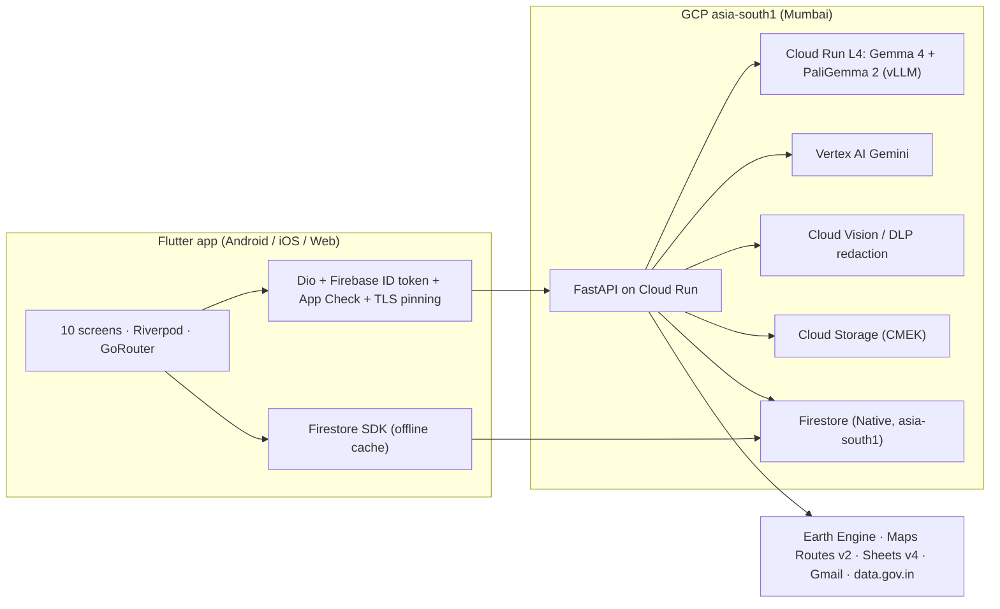

# Arogya Drishti — Implementation Plan

Production-grade vector-borne disease surveillance DPI for the Government of India.
Sources: [master_architectural_prompt.md](file:///Users/shivamyadav/Projects/arogyadrishti/master_architectural_prompt.md), [DESIGN.md](file:///Users/shivamyadav/Projects/arogyadrishti/DESIGN.md), [ui_design.png](file:///Users/shivamyadav/Projects/arogyadrishti/ui_design.png), [toolstouse.txt](file:///Users/shivamyadav/Projects/arogyadrishti/toolstouse.txt), `teamrocket_service.json`.

---

## ✅ Decisions locked (Oct 22)
- **Scope:** full spec, built in phase order.
- **Models (updated per review):** **Gemma 4**. A single `google/gemma-4-12B-it` covers both the multilingual agent chat **and** breeding-site object detection (native bounding boxes, variable-aspect images), replacing Gemma-2-9B + PaliGemma-3B. Served at FP8 (~13 GB) so it fits one 24 GB L4 with KV-cache headroom.
- **Hosting:** vLLM on **one Cloud Run NVIDIA L4 GPU in `asia-south1`**, scale-to-zero, OpenAI-compatible API (tool calling + image input).
- **SA key:** moved to `~/.config/arogyadrishti/` (chmod 600), `.gitignore` + gitleaks added.

## 0. Critical findings (read first)

> [!CAUTION]
> **Leaked-key risk.** `teamrocket_service.json` is a **Firebase Admin SDK private key** (`firebase-adminsdk-fbsvc@teamrocketnp`) sitting in the project root. The bonus prize needs a **public GitHub repo**, so one careless `git add .` would publish full admin access to your project.
> Plan: move it to `~/.config/arogyadrishti/`, add it to `.gitignore` plus a pre-commit secret scanner, and **use no key file in production**: Cloud Run will run as its own service account through Workload Identity. Rotate this key after the hackathon.

> [!WARNING]
> **Timeline.** `toolstouse.txt` says the pitch is **tomorrow (Oct 23)**. The full spec (6 backend tools, 10 screens, agent harness, self-hosted GPU models, VAPT-grade hardening) is several days of work. See question Q1: I'll build in **demo-critical order** so whatever is finished is fully working and deployed. Nothing will be half-built.

> [!IMPORTANT]
> **The reference code in `toolstouse.txt` breaks your own zero-mock rule.** We'll fix these points, not copy them:
> - Silent fallbacks such as `or 28.5` / `or 0.15` / `or 42.0` fake the satellite values. We'll return an explicit `data_unavailable` state plus the Sentinel-1 SAR fallback instead.
> - Hardcoded dates (`"2026-10-15"`) → rolling windows computed at request time.
> - `str(firestore.SERVER_TIMESTAMP)` writes the literal sentinel text into the Sheet → use a real UTC ISO timestamp.
> - Fake fallback contacts (`"dmo@gov.in"`, `"104"`) → return an explicit "no contact on record" error.
> - Sheet updates by fixed column index (`update_cell(row, 7, …)`) → look up columns by header name.

### Environment check (done)
| Item | Status |
|---|---|
| Flutter 3.47.6 / Dart 3.13.5 | ✅ |
| Android SDK, Xcode 27 | ✅ |
| Firebase CLI 14.20, project `teamrocketnp` visible | ✅ (no default location set yet, so we can still pin `asia-south1`) |
| `gcloud` CLI | ❌ needs install (Cloud Run, Earth Engine, IAM) |
| Docker | ❌ not needed: we'll use Cloud Build remote builds |
| Git repo | ❌ not initialized (good: key not committed yet) |

### Research decisions
| Topic | Finding | Decision |
|---|---|---|
| Open-weight LLM | Gemma 4 (E2B/E4B/12B/26B-A4B/31B) is current | **`google/gemma-4-12B-it`** at FP8 |
| Open-weight VLM | Gemma 4 does detection, pointing and OCR natively | **Same Gemma 4 model**, so PaliGemma is dropped (one GPU instead of two). Gemini on Vertex cross-checks low-confidence detections |
| GPU in India | Cloud Run **NVIDIA L4 is available in `asia-south1`** (min 4 vCPU / 16 GiB) | Self-host Gemma 4 on one Cloud Run GPU in Mumbai, meeting data-sovereignty rules |
| Gemini model ID | Will check with `models.list` on Vertex AI `asia-south1` when implementing | Kept in config, never hardcoded |
| Database | Spec mixes Firestore, PostGIS, sqflite and Hive | **Firestore (offline persistence) + Google Sheets ledger**, as in the master prompt. Drop PostGIS/sqflite/GKE/Apigee for v1 and document them as the scale-out path |
| Firestore shape | Nested `states/…/wards/…` vs flat `field_logs` | **Flat top-level collections** keyed by `lgd_code` + `geohash`. Simpler indexes and rules, same pan-India scale |
| Sheet→alert mirroring | Cloud Functions vs backend | **Backend writes directly** (one audit path, one retry policy) |

---

## 1. Target architecture

---

## 2. Phased build: each phase must pass its production gate before the next one starts

Every phase finishes with: `dart analyze` / `ruff` + `mypy` clean, tests green, a smoke test against **live** services, and a git commit.

### Phase 0: Repo, security and monorepo skeleton
- Move the SA key out of the repo, add `.gitignore`, `gitleaks` pre-commit hook, `git init`.
- Folder tree exactly as in master prompt §1. Add `LICENSE` (Apache-2.0), `README.md`, `.env.example`, `SECURITY.md`.
- **Gate:** `gitleaks detect` clean, and no `*.json` keys tracked by git.

### Phase 1: Cloud foundation (all resources in `asia-south1`)
- Install `gcloud`. Enable the APIs: Run, Build, Artifact Registry, Firestore, Storage, Vision, DLP, Vertex AI, Earth Engine, Sheets, Gmail, Routes, Maps SDKs, Secret Manager, KMS, App Check.
- Firestore Native in `asia-south1`; GCS bucket with a CMEK key from Cloud KMS; Secret Manager for every API key.
- Runtime service account with least-privilege IAM. Register it for Earth Engine.
- Firebase: Phone Auth (needs the Blaze plan), Android SHA-1/256, App Check (Play Integrity / App Attest / reCAPTCHA Enterprise).
- Create the **Master Spreadsheet** with 5 header-validated tabs, shared with the runtime service account.
- **Gate:** a script verifies every API responds from the service account, and the region of every resource is `asia-south1`.

### Phase 2: Backend core
- `config.py` (Pydantic Settings, fails fast at startup), `security.py` (Firebase ID-token + App Check verification, role claims, PII scrubber), `exceptions.py` (RFC 7807 errors), structured JSON logging with Cloud Trace IDs.
- Middleware: CORS allow-list, rate limiting (slowapi now, Cloud Armor in front later), security headers, request-size limits.
- **Gate:** pytest ≥ 85% coverage on core; the container boots on Cloud Run; `/healthz` and `/readyz` are green.

### Phase 3: Six backend tools (one isolated folder each; tenacity retry, Pydantic I/O, custom exceptions, tests)
| # | Tool | Live smoke test |
|---|---|---|
| 1 | `sheets_admin_tool` | read every tab, append and roll back a row |
| 2 | `gee_climate_tool` | LST/NDWI/NDVI/CHIRPS for Chandigarh; SAR fallback path |
| 3 | `maps_routing_tool` | real ETA + polyline between two Chandigarh points |
| 4 | `vision_paligemma_tool` | face/plate blur → PaliGemma boxes → risk fusion |
| 5 | `gmail_alert_tool` | MX check + real email to a team inbox |
| 6 | `ogd_india_gov_tool` | real PHC records from `api.data.gov.in` |
- **Gate:** each tool passes unit tests (HTTP mocked **only in tests**) and its live smoke test.

### Phase 4: API endpoints
`POST /auth/verify-staff` (sets custom claims) · `POST /dispatch-action` · `POST /scan-breeding-site` · `GET /centers` · `GET /vans` · `GET /contacts` · `POST /agent/chat` (SSE streaming) · public `GET /risk-index` (OpenAPI-documented, rate-limited).
- Idempotency keys on dispatch so an offline retry can't send two vans.
- **Gate:** contract tests against the OpenAPI schema; deployed to Cloud Run; end-to-end `curl` checks.

### Phase 5: Bonus: open-source Agent Skill + Gemma harness
- `skills/vector-surveillance-skill/SKILL.md` (spec frontmatter, NCVBDC dosage tables, WHO thresholds), `schema.json` (JSON Schema tool declarations).
- `gemma_agent_harness.py`: an OpenAI-compatible tool-calling loop (vLLM / Ollama / Vertex) with the 4 tools; `skill_executor.py`: an allow-listed dispatcher with timeouts.
- Gemma 4 + PaliGemma 2 served with vLLM on a Cloud Run L4 GPU in `asia-south1`.
- **Gate:** the harness runs locally against Ollama **and** against the deployed endpoint; the skill passes schema validation.

### Phase 6: Flutter foundation
- Theme tokens taken exactly from `DESIGN.md` (Plus Jakarta Sans, tabular figures, crimson palette, AI gradient, elevation rules); shared components (cards, triage badges, sync pill, AI chip, vector density gauge).
- Riverpod (code-gen), GoRouter with an auth guard, Dio (ID token + App Check interceptor, retry, **SPKI pinning with backup pins**), `flutter_secure_storage`, Firestore unlimited offline cache, `awesome_snackbar_content`, l10n **en / hi / pa** via ARB files.
- **Gate:** golden tests for the core components; app boots on an Android emulator and on web.

### Phase 7: Screens (ordered by demo value; every one bound to live data)
1. **Auth**: +91 OTP → verify-staff → claims
2. **Home**: profile, GPS/ward, quick actions, `ActionDispatchBottomSheet`, field form with HI/CI/BI, offline queue
3. **Scan**: camera + GPS → redacted upload → risk tier + GEE overlay
4. **Stats**: live HI/CI/BI, 8-week `fl_chart` trend + rainfall, IHIP/NCVBDC CSV + FHIR export, escalate
5. **Vans**: live fleet, polylines, ETA countdown, call driver
6. **Map**: risk circles, breeding markers, ward bottom card
7. **Chat**: streaming Gemma copilot with tool-result cards
8. **Centers**, 9. **Support**, 10. **Settings** (pending-write counter, force sync, language, DPDP disclosures)
- Each screen has loading / empty / error / offline states, a11y labels, 48dp touch targets, and works at 360dp width.
- **Gate per screen:** widget test + manual run on device against production.

### Phase 8: Security and compliance hardening
- `firestore.rules` / `storage.rules` (role + `lgd_code` scoping, field validation, immutable audit logs), plus composite indexes (`lgd_code` + `timestamp`).
- OWASP MASVS L1 checklist: obfuscated release builds (`--obfuscate --split-debug-info`), no secrets in the APK, root/jailbreak warning, screenshot blocking on sensitive screens, network security config.
- DPDP: consent screen, data-minimisation notes, retention policy, grievance-officer contact.
- **Gate:** Firebase rules emulator tests; security audit using the `firebase-security-rules-auditor` skill; MASVS checklist in `SECURITY.md`.

### Phase 9: Deployment
- Multi-stage `Dockerfile` (gunicorn + uvicorn, non-root, distroless), `cloudbuild.yaml`, `deploy.sh`, `docker-compose.yml` for local runs.
- Signed release APK/AAB and web build deployed to Firebase Hosting (served from India where possible).
- **Gate:** one-command deploy from a clean checkout succeeds; app installs from the APK.

### Phase 10: QA and pitch kit
- End-to-end run of the demo script (Scan → Sheet row → Gmail → Van ETA → Hindi chat).
- README architecture diagram, rubric mapping, and a short demo video (optional `/brag` skill).

---

## 3. What I need from you

| # | Item | Why |
|---|---|---|
| 1 | **Blaze plan** on `teamrocketnp` | Phone Auth, Cloud Run, GPU, Vertex |
| 2 | Permission to install `gcloud` and log in with `gcloud auth login` | All GCP setup |
| 3 | **Google Maps API key** (or I create one, restricted) | Maps SDK + Routes v2 |
| 4 | **data.gov.in API key** (free at data.gov.in) | OGD PHC / LGD data |
| 5 | Gmail sender account (Workspace + domain-wide delegation, **or** a Gmail App Password for SMTP) | Alert emails |
| 6 | **Real** rows for vans / staff (your team's own phones and emails are fine: they are real records, not mocks) | Zero-mock rule; health centers come from OGD |
| 7 | Android package name, e.g. `in.teamrocket.arogyadrishti` | Firebase app registration and signing |

## 4. Open questions
See the questions in chat (timeline/scope, GPU hosting, model versions).
